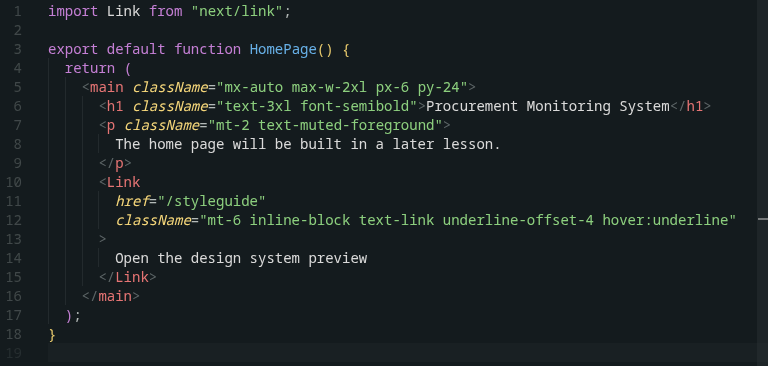
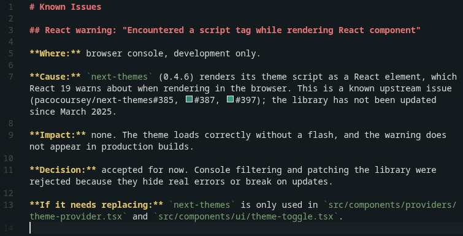

<p align="center">
  
</p>

<h1 align="center">Blushwood</h1>

<p align="center">A soft, low-glare dark theme for VS Code, inspired by <a href="https://github.com/Everblush">Everblush</a>.</p>

---





## Features

- Muted dark background with a blush-red accent
- Syntax colors tuned for long sessions and night coding
- Full Markdown styling: headings, bold, italic, inline code, links, quotes, lists, and code fences
- Matching integrated terminal colors
- Bracket pair colorization and git decoration colors

## Installation

### From a release

1. Download the latest `.vsix` file from the [Releases](https://github.com/YOUR-USERNAME/blushwood-theme/releases) page.
2. In VS Code, open the Extensions view, click the `...` menu, and choose **Install from VSIX...**
3. Select the downloaded file.
4. Open the Command Palette (`Ctrl+Shift+P`), run **Preferences: Color Theme**, and pick **Blushwood**.

### From source

```bash
git clone https://github.com/YOUR-USERNAME/blushwood-theme.git
cd blushwood-theme
npx @vscode/vsce package
code --install-extension blushwood-theme-*.vsix
```

## Palette

| Color | Hex |
|---|---|
| Background | `#141b1e` |
| Panels | `#10171a` |
| Foreground | `#dadada` |
| Comments | `#5c6466` |
| Red (accent) | `#e57474` |
| Green | `#8ccf7e` |
| Sage (inline code) | `#7da375` |
| Yellow | `#e5c76b` |
| Blue | `#67b0e8` |
| Magenta | `#c47fd5` |
| Cyan | `#6cbfbf` |

## Recommended settings

```json
{
  "editor.fontFamily": "'JetBrains Mono', monospace",
  "editor.fontLigatures": true,
  "editor.bracketPairColorization.enabled": true
}
```

## Credits

Color palette inspired by [Everblush](https://github.com/Everblush). Blushwood is an independent theme and is not affiliated with the Everblush project.

## License

[MIT](LICENSE)